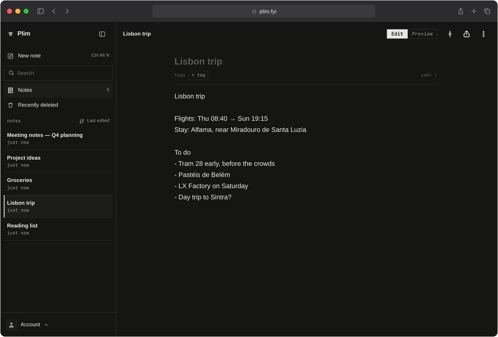
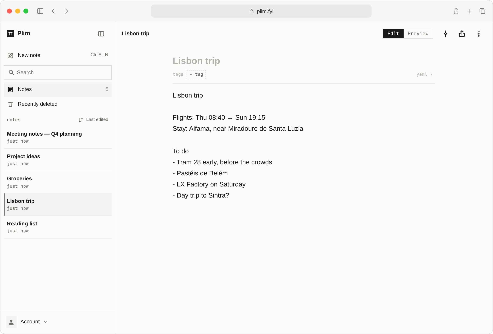
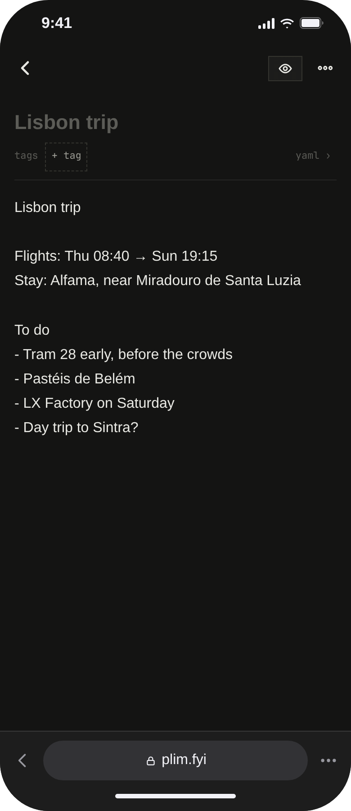
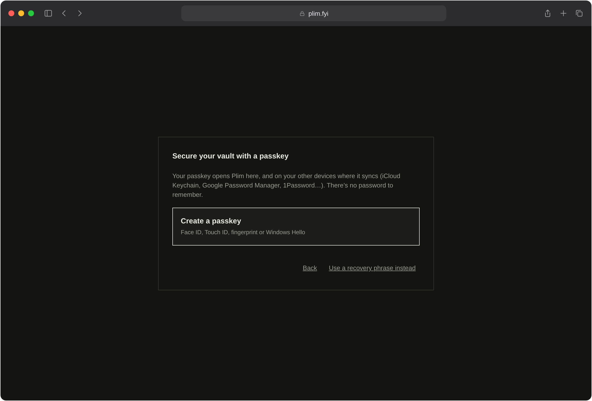
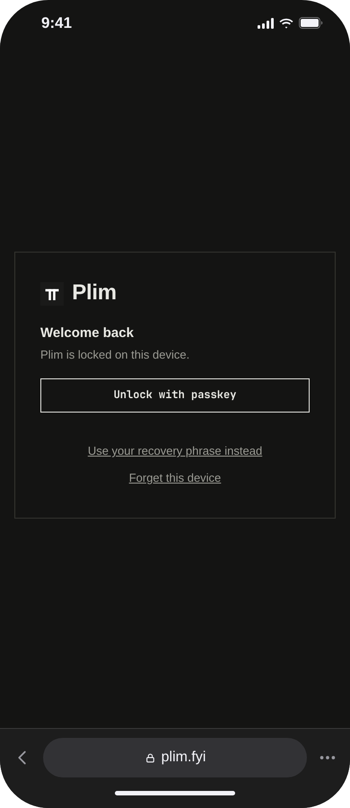
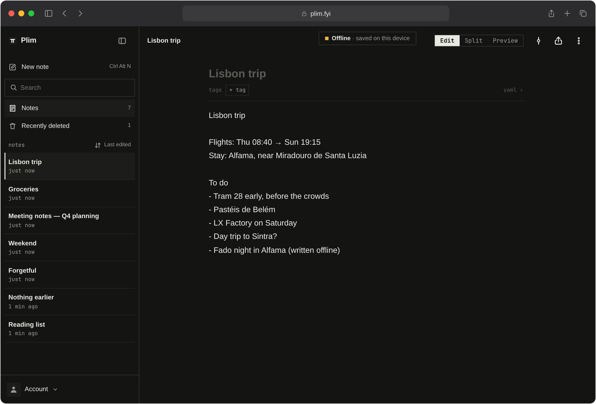
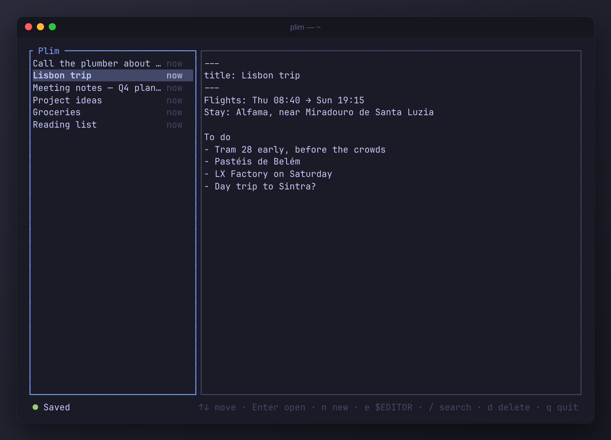
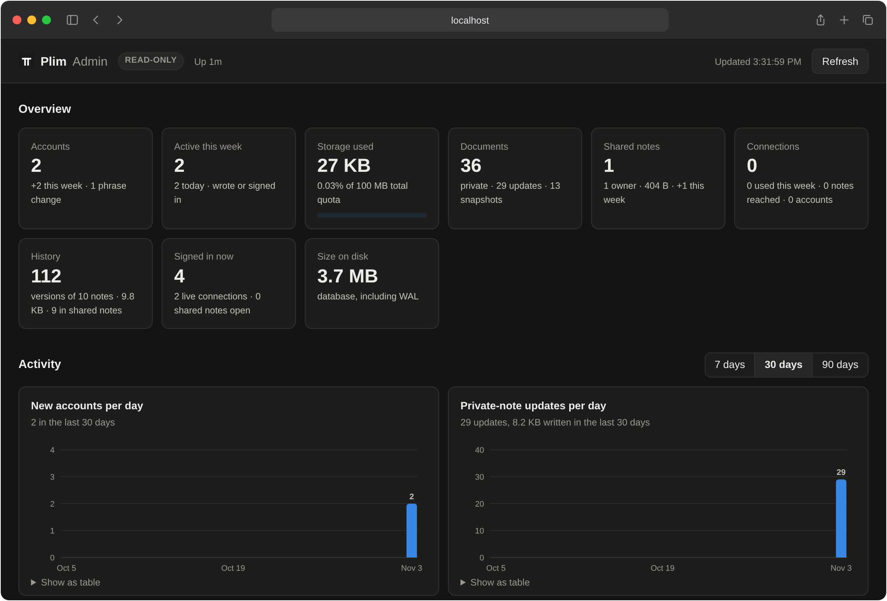

#  Plim

Your notes, on every device. No account to create and no password to remember: you sign in with a passkey in any browser, and your account is backed by a 12-word recovery phrase (BIP-39). Notes are end-to-end encrypted, so the server stores only ciphertext.

**[about.plim.fyi](https://about.plim.fyi)**: what Plim is, in a page.

**[Install the terminal client](#terminal-client)**: `plim`, for Linux and macOS ([releases](https://github.com/plim-fyi/plim/releases/latest)).



| Light mode | On an iPhone |
|---|---|
|  |  |

- **Use it** at [plim.fyi](https://plim.fyi), or **run your own server**: [Quick start](#quick-start), then [Deploying](docs/DEPLOY.md).
- **Everywhere:** a web app that works offline and installs on a phone's home screen, and [`plim`](#terminal-client) in a terminal, for scripts too.
- **Shared notes** with live cursors, a link per note ([Shared notes](#shared-notes)); **History** of every note; **export** as plain Markdown files.
- **AI agents** reach only the notes you share with them, through a connector ([Claude and other MCP clients](#claude-and-other-mcp-clients)).
- **What the server still sees**, and other trade-offs: [Known limitations](#known-limitations). Found a hole? [SECURITY.md](SECURITY.md). Want to help? [CONTRIBUTING.md](CONTRIBUTING.md), or [buy it a coffee](#support-plim).

**Contents**
- [Features](#features): [writing](#writing), [finding and organizing](#finding-and-organizing), [keeping your notes](#keeping-your-notes), [sync, sharing and devices](#sync-sharing-and-devices), [security](#security)
- [Quick start](#quick-start)
- [Using Plim](#using-plim): [signing in](#signing-in), [on a phone](#mobile-and-add-to-home-screen), [offline](#offline), [shared notes](#shared-notes)
- [Terminal client](#terminal-client) and [releases](#releases)
- [Claude and other MCP clients](#claude-and-other-mcp-clients): [connecting over the web](#connecting-claude-over-the-web)
- [Running a server](#running-a-server): [admin dashboard](#admin-dashboard), and [Deploying](docs/DEPLOY.md)
- [Development](#development): [tests](#test), [code organization](#code-organization), [how notes sync](docs/SYNC.md), [contributing](CONTRIBUTING.md)
- [Known limitations](#known-limitations) · [Support Plim](#support-plim) · [License](#license)

## Features

Everything here works the same on plim.fyi and on a server of your own.

### Writing

- **Editor:** CodeMirror 6, which only draws what's on screen, so typing stays quick in long notes. It's bound to Yjs with `y-codemirror.next`, and undo only undoes your own edits.
- **Markdown, with a Preview:** on a computer a note opens in the editor, showing its markdown as it is; on a phone it opens as a page (a new note in the editor, ready to type), and a tap on a word edits there, the keyboard up. **Preview** (a toggle in the bar on a phone; **Edit / Split / Preview** on a computer, Ctrl/Cmd+/ to go round them, kept until you switch) shows it rendered: headings, bold, links, quotes, code, real tables, tasks (`- [ ]`) as checkboxes you can tick, with native scrolling and selection. A line break is a line break, as in the editor (the "breaks" reading most notes apps use). Switching keeps your place to the pixel: the line at the top of the screen, or the line you're typing on, stays where it is. A tap on a word in Preview edits there, the cursor on that word. **Split** shows the markdown and the page side by side, scrolling together: whichever side you scroll, the other follows, matched block by block (a heading or a table taller on one side doesn't put them out of step); while you type, the page keeps the block you're in level with your line, tinted. Others' edits redraw Preview without moving what you're reading; in a shared note each person shows as a marker in their colour beside the line their cursor is on, and a block someone just changed lights up and fades. On a phone, the editor shows others' cursors with their names too. A view-only link opens in Preview. The note itself is plain markdown, so sync, History, the terminal client and export see the same text. Typing knows markdown: Enter continues a list (and ends it on an empty item), Tab indents an item, Ctrl/Cmd+B, I, E and K make bold, italic, code and links, Ctrl/Cmd+Enter ticks a task. Clicking into a link shows a card with where it really goes, to open or copy (its text can say otherwise); Ctrl/Cmd+click opens it at once.
- **A new note is dated:** its title is when it was made (`title: 2026-10-09 9:14 PM` in its frontmatter), shown in the note's header. On a computer the title starts selected, so typing names the note and Enter goes on to the body; on a phone the cursor is in the body, and a tap on the title renames it.
- **Type `/` for a menu:** at a line's start or after a space, `/` offers Today (`2026-10-09`, this device's calendar day), Now (`2:32 PM`), Yesterday, and Date and time. Typing after it filters (`/tod`), and a pick replaces the `/` in one undo step: Enter or Tab on a computer, a tap on a phone (Return there picks once a filter is typed). The `/` is typed as itself, so ignoring the menu changes nothing; it doesn't open after a character (`and/or`, addresses) or in code.
- **Title and tags, in frontmatter** (#584): a note's title and tags are in a YAML block at its top, as other markdown tools write it:
  ```
  ---
  title: Leg day
  tags: [gym, gym/legs]
  ---
  ```
  The app folds the block into the note's **header**: the title, to edit in place, and the tags as badges (**×** takes one off; a tap lists its notes), with **+ tag** (a picker of the tags you use, most used first, with how many notes each; type to narrow it, Enter or a tap puts one on) and **yaml ›** (the block itself, in the editor). The same over Preview, and on a phone. A `#word` in the text is only text. A note without a `title:` is titled by its first line. Your notes written before were moved into blocks once, on the first unlock after the change (their first line their title, every tag they had their tags; each kept as a version first, so History has it as it was).

### Finding and organizing

- **Search** is the field under New note (`Ctrl+Shift+F`). The list becomes the notes that have every word you type, whatever its case or accents (`cafe` finds `Café`), with the lines that matched under each title; it searches the view you're in, and the tag picked over the list, if any. Opening a result shows every match in the note, with a bar to go from one to the next (`Ctrl+G`). It runs on your device, over your notes' text: the server can't read them, so it can't search them. A note this device hasn't opened yet is fetched to be searched, and kept here like any other.
- **Tags** sort notes: your tags are chips over the list, on one row that scrolls sideways (a swipe, or a wheel): pick one to list its notes, and it moves to the front with an **×**; tap it again for every note. A tag is a word: `gym/legs` is a chip of its own, and `#gym` lists only the notes tagged `gym`. A new note made with a tag picked starts with that tag. Each note's row in the list shows its tags after its date (`3 h ago · #gym #training`). The terminal client lists, reads and counts notes by tag and tags them (`plim ls --tag gym`, `plim cat --tag gym`, `plim tags`, `plim tag`), so an AI agent can gather everything tagged `#gym` and answer from it. A note's tags are kept beside its title in the encrypted note list, put right whenever the note is edited or opened.
- **Sort the list:** by when each note was last edited (as it starts) or by when it was made, from the button beside the list's label ("Last edited"); newest first either way, kept on the device. Each note's date follows the order ("3 h ago", or "Created Oct 2"), and by date created a note you're editing stays where it is. The order holds with a tag picked; Recently deleted keeps its own. `plim ls --sort created` does the same in the terminal.
- **Every note has an address,** `https://<server>/n/<id>`, the note's for life (#299): it's in the address bar while the note is open, so a bookmark, a reload or Back and Forward bring the note back, and it opens offline. **Copy link** (a row's menu, or the note's ⋮) copies it. Only the id is in it, never a title, and a bare address opens nothing for anyone without access to the note, so it's safe to paste anywhere: a name for the note, not a key to it. The terminal client takes it wherever it takes a note (`plim cat <url>`), and prints it after a write.

### Keeping your notes

- **History:** the clock above a note lists its earlier versions by day (one at most hourly while it's edited, all of them kept: compressed, and only the oldest go if your storage fills up), each with its time, who made it if an AI did (its app and session: "Claude · amber fox", #505), how many lines it added and removed, and a line saying what it changed ("Added “Tram 28”"). Pick one (or move through them with the arrow keys) to read the whole note as it was, its changes marked; **Hide unchanged lines** folds the rest away. **Copy text** copies that version, and **Restore this version** puts it back as a single edit you can undo. On a phone, History is a screen of its own: the versions, then one at a time. A note with no versions yet says so in a small dialog. A long history lists the newest 60 first (**Show earlier versions** for more), each version's text fetched only once its row is in sight; a run of versions by one app's session, five minutes apart at most (an agent at work), is one row that opens to show them. Settings → Storage says how much of your space is history. **Forget history…** under the versions deletes them all for good, on every device, signed with your key (asked first; the note itself stays as it is): for text you don't want kept anywhere.
- **Recently deleted:** Delete has an Undo, and deleted notes can be restored for 30 days. Recently deleted is a view in the sidebar (on a phone, at the end of the list): pick a deleted note to read it where a note goes, as a page, with **Restore** and **Delete forever** beside it (on a phone, a screen of its own, the two in reach at the bottom). A note deleted on one device while another was still editing it (say, offline) comes back, with a message, so those edits aren't hidden. "Delete forever" (or the 30 days running out) takes the note out of reach and frees its storage. The server keeps its data 30 days more, so it can still be restored from **Deleted forever** in Recently deleted; after that it's gone for good.
- **Export, your notes as plain files (#47):** Settings → Account → **Export all notes** saves one zip, `plim-notes-<date>.zip`, a Markdown file a note: its text as written (title and tags already in its frontmatter), plus `created`, `updated` and `id` there, so Obsidian and the like read its dates and tags, and `shared: true` on a note someone shared with you. A file is named for its note's title (made safe for every system; two of one name: `Name (2).md`, the older keeps it), dated its last edit; Recently deleted's are in `deleted/`. It's made on the device from the notes as it decrypts them, never on the server, and works offline from this device's copies (saying which it couldn't include). **Download** in a note's menu saves that note's file alone. `plim export <dir>` makes the same files in a folder. The files aren't encrypted.
- **Settings** (your menu, bottom left): **Profile** (the name others see beside your cursor in a shared note), **Editor** (how markdown, Preview and Split work, and the shortcuts), **Appearance** (the theme: light, dark, or as your system has it, on this device; set before the page is drawn, so it never flashes the other), **Sign-in & security** (passkeys, the recovery phrase, this device's auto-lock), **Storage** (how much of your quota your notes, their history and your shared notes use), and **Account**.
- **Delete your account:** Settings → Account → Delete account (or `plim delete-account`) removes everything of it from the server: notes, history, keys, sessions and the notes you've shared, whose links stop working. It's signed with your account key, so a stolen session can't do it.

### Sync, sharing and devices

- **Notes** are Yjs CRDT documents. Every edit is encrypted, signed and appended to the server as an opaque blob. Snapshots compact the history. [How notes sync](docs/SYNC.md) explains it, with diagrams.
- **Autosave:** edits are written to an encrypted IndexedDB outbox immediately and uploaded after a 400 ms pause (or at least every 2 s while typing). They survive tab closes and lost connections.
- **Live sync:** a WebSocket pushes what your other devices save, so an edit shows up on them in well under a second instead of at the next poll. Uploads still go over HTTP. While the socket is down, the app polls instead (every 5 s after activity, backing off to once a minute); while it's up, only a safety poll every 5 minutes.
- **Shared notes:** share a note with a link to edit or one to view, with no account needed to open it. It stays end-to-end encrypted, and everyone's edits and cursors show up live. See [Shared notes](#shared-notes).
- **Works offline:** the app opens, unlocks and edits without the server, and syncs when it's back. See [Offline](#offline).
- **Feels like an app on phones:** no zooming or page bounce, and Add to Home Screen opens it full screen. See [Mobile](#mobile-and-add-to-home-screen).
- **Passkey sign-in:** sign in with Face ID, Touch ID, a fingerprint or Windows Hello on any device where your passkey syncs. The 12 words are the backup. See [Signing in](#signing-in).

### Security

- **Keys:** phrase → seed → HKDF → Ed25519 signing key (identity) + key-encryption key. The KEK wraps a random *vault key*, and each note gets its own AES-256-GCM key derived from it.
- **Rollback detection:** warns if the server serves older data than this device has seen before (for example, a restored backup or withheld updates).
- **Hardening:**
  - strict CSP with no inline code and self-hosted assets only (the editor's `<style>` gets a fresh per-load nonce)
  - HSTS, so a browser that has been to the site once never loads it over plain HTTP
  - domain-separated signatures
  - proof-of-work on signup
  - per-account quota and rate limits
  - recovery-phrase rotation (re-encrypts under a new vault key and revokes the old phrase)

## Quick start

```sh
cargo run -p plim-server     # http://127.0.0.1:3000
```

Open http://127.0.0.1:3000 and create a vault. Outside `localhost` the web app needs HTTPS, because WebCrypto only works in a secure context.

To run it for real (settings, the container image, starting at boot, a Cloudflare Tunnel in front), see [Deploying Plim](docs/DEPLOY.md).

## Using Plim

Signing in, using it on a phone and offline, and sharing a note.

### Signing in

There are two ways into a vault: a **passkey** or your **12 words**.

- **Creating a vault:** **Create a new vault** asks for a passkey, and that's it. Plim makes your 12 words in the background. If your browser or password manager can't do it, or you choose **Use a recovery phrase instead**, you get the 12 words straight away to write down and confirm. A server at its account limit (`PLIM_MAX_ACCOUNTS`, see [Deploying](docs/DEPLOY.md#configuration)) says it isn't taking new vaults; signing in still works.
- **Your 12 words:** they're the account's master key, and the only way back in if you lose your passkeys. A vault made with a passkey shows a **Save your recovery phrase** reminder until you've seen them in **Settings → Sign-in & security → Recovery phrase** and tapped **I've saved it**. That's remembered for the account, so it counts on all your devices.
- **Another device:** **Sign in with a passkey** works wherever your passkey syncs (iCloud Keychain, Google Password Manager, 1Password). Anywhere else, sign in with the 12 words. Plim then offers to add a passkey there.
- **Locked device:** a device that has used a passkey opens on a **Welcome back** screen. **Use your recovery phrase instead** is always there. **Forget this device** removes its offline copies and brings back **Create a new vault**. Your passkeys keep working.
- **Managing passkeys:** **Settings → Sign-in & security → Passkeys** lists them, adds new ones, renames and removes them. Removing one stops it signing in on every device.
- **Passkey names:** a new passkey is named after its password manager when Plim recognises it (e.g. "iCloud Keychain"), otherwise after the browser ("Chrome on macOS"). Names are kept in the encrypted note index, so they sync to your devices and the server never sees them.

<p>
  
  
</p>

**How the passkey opens your vault:**
- **The secret:** it uses the WebAuthn **PRF** extension. The passkey derives a secret that never leaves it. That secret encrypts your 12 words' entropy, and the server keeps the encrypted copy so a new device can fetch it. Without the passkey the copy is useless, to the server or anyone else.
- **Offline:** each device also keeps the copies it has used, so a passkey unlocks offline too.
- **Support:** recent Chrome and Edge (with Google Password Manager, Windows Hello or a security key), Safari 18+ with iCloud Keychain, and 1Password. Proton Pass supports it in its browser extension but not, for now, in its iOS app. If a provider lacks PRF, Plim says so, and the 12 words remain the way in.
- **Bound to the site's address:** a passkey made on `plim.example.com` won't work on `localhost`. If you move your server to a new address, sign in with the 12 words and add a passkey again.
- **Who can get in:** anyone who can use one of your passkeys can open your notes. If your passkeys sync, that includes anyone who takes over your iCloud, Google or 1Password account.
- **Changing the recovery phrase** removes every passkey's copy, because they hold the old phrase. Plim then offers to keep using the passkey on that device, which re-encrypts the new phrase with it in one prompt.

**Refresh and auto-lock:**
- Your keys exist only in the open page, so **refreshing locks the vault**, and so does **Log out** in your menu (bottom left).
- Locking also ends the page's session on the server at once, as closing or reloading the tab does, so a session token that leaked stops working then rather than 15 minutes later. The terminal client ends its session when each command finishes.
- While the tab stays open, the vault also **locks itself after 15 minutes without activity** (typing, clicking, tapping or scrolling).
- Time asleep or in a background tab counts as idle.
- Pending edits are saved first.
- Change it in **Settings → Sign-in & security → This device → Auto-lock** (5 / 15 / 60 minutes / Never). The setting is per browser.

### Mobile and Add to Home Screen

- The web app turns off pinch and double-tap zoom, and the page doesn't bounce or pull to refresh, so it behaves like an app. Lists and the editor still scroll normally. Browser text-size settings still work. iOS 16 or later is needed for the no-bounce part.
- **Add to Home Screen** (Safari: Share → Add to Home Screen; Chrome: Install app) opens Plim full screen with its own icon, clear of the notch and home indicator.
- On iOS, a home-screen app keeps its own storage, separate from Safari. Sign in there once with your passkey or your 12 words.

### Offline

Plim keeps working when the server can't be reached: no network, or the server or its tunnel is down.

- **Opening the app:** a service worker (`web/sw.js`) keeps the page and its scripts on the device. Locking, refreshing, auto-lock and the home-screen app all work offline. Online, the page always comes from the network, so updates still arrive straight away.
- **A page left open across an update:** every answer from the server names the version of the app it has (`X-Tiro-Version`, and on the live socket). A page running another one says **Plim was updated · Reload**, on the app and on a shared note's page. Your edits are saved first.
- **When something breaks:** if the app's scripts don't load or fail as it starts, the page says **Plim couldn't start**, with the error and a Reload button, instead of staying blank. A note that fails to open says why where it would be, with Reload. Edits waiting to upload are kept on the device either way.
- **Reading and writing:** each note's latest state is kept on the device, encrypted with that note's key. Notes open instantly, and offline they open from this copy. Edits go to the encrypted outbox as before, and an **Offline** bar shows across the top.
- **Unlocking:** each sign-in saves the encrypted keyring on the device. It's wrapped with the key from your 12 words, exactly as the server stores it. Offline, a passkey this device has used, or the 12 words, open the vault from that copy.
- **Back online:** Plim signs in again by itself, uploads waiting edits, and fetches changes. Edits made offline on two devices merge. If the recovery phrase was changed elsewhere meanwhile, the device locks and asks for the new phrase; its waiting edits upload after that.
- **Needs a connection:** creating a vault, the first sign-in on a device, changing the recovery phrase, and listing or removing passkeys. A passkey added offline is uploaded once the device is back online.
- **What's stored:** only ciphertext. "Forget this device" removes the offline copies too, but keeps edits not yet uploaded.
- **Storage limits:** once a device has used a passkey, Plim asks the browser to keep its storage. Even so, Safari may clear a website's data after about 7 days without a visit; apps added to the home screen are exempt. The server still has everything except edits that haven't been uploaded yet.

<p>
  
  
</p>

### Shared notes

**Share** above the open note (the share icon, with a green dot once it's shared with people and live; or a right-click / long press on it in the list → **Share…**) gives two links: one to edit, one to view. Anyone with a link can open the note in a browser, with no account needed. Plim users can add it to their own list. Edits and cursors show up live for everyone in the note, with each person's name. Until you set a name, you're a character from Middle-earth, the same one each time on a given device.

A link is the note's own address with the key after the `#`: `https://<server>/n/<note id>#k=<share id>.e.…` to edit, `…r.…` to view. The address stays the note's whether it's private or shared, and for everyone in it; replacing the links changes only what's after the `#`. Opened with a Plim vault on the device, the link opens the app (the note, or **Add to my notes**); without one, the note's page for guests. Links made before (`/s/<share id>#…`) keep working.

The note stays end-to-end encrypted, because its key is in the link after the `#`, which browsers never send to the server.
- An edit link carries a random 32-byte seed. From the seed come the encryption key, an Ed25519 signing key, and a read token.
- A view link carries the encryption key, and gets its read token from it. It also carries the signing key's public half.
- The server stores the signing key's public half and a hash of the read token. Reading needs the token. Writing needs a signature from the signing key, so a view link can't write.
- Every client checks those signatures too, so a server can't pass off edits either, not even with someone's view link. A change without a valid signature is ignored, with a warning.
- Cursors and names are encrypted with the note's key too. The server relays them and never stores them.

**What the server sees:** that a note is shared, by whom, its size and when it changes, and the IP addresses of the people who open it. It doesn't see the text, cursors or names.

**Limits:**
- Reads are rate-limited per IP address, including token checks over the live socket, so a link's token can't be guessed quickly. Writes are rate-limited too.
- A shared note counts against its owner's storage, and one shared note can use at most a quarter of it. Someone with the edit link can fill that quarter, not the owner's whole account.
- Opening "Add to my notes" from a link asks first, so a link from someone else can't put a note in your list unasked.

**Keep in mind:**
- **A link is the key.** Anyone you, or they, forward it to has the same access. Links can end up in browser history, chat logs and screenshots. To cut off access, **Stop sharing**, or replace the links, which gives the note a new key.
- **Links for people:** **A link for someone…** in the Share dialog gives a person a link of their own (`/n/<id>#h=…`), to edit or only view; they're listed under **Who has this note**, with the apps that reach it. **Remove** takes one back without touching the others: the note gets new keys, and the other people's links follow (the plain links are replaced too). **Replace links** keeps them working. Their links don't carry the key: the server holds each person's copy of it, sealed to their link's secret, and hands it over to that secret alone. In the terminal: `plim share <note> --for Sam` (`--view` for a read-only one).
- **Anyone with the edit link can change or delete the text.** History (the clock above the note) keeps earlier versions to restore, and when someone else's edit wipes most of the note, your app keeps it as it was just before. Anyone with the edit link can see and restore them too.
- **Names and cursors aren't verified.** Anyone in the note can call themselves anything (up to 40 characters, shown as plain text). What others send is checked before it's shown, so a bad cursor can't break the editor.
- **Guests keep an encrypted copy** of the note and their unsent edits in the browser, so the link opens and edits offline too. Stopping sharing ends their access to new edits, but not to what they already have.
- **View links made before #77 can't check signatures.** They don't carry the public key, so they take the server's word for who wrote what. Replace the links to get ones that check.

## Terminal client

`plim` is a native client that talks to the same server and reads and writes the same notes as the web app. All encryption happens locally, as in the browser. It uses `yrs`, the Rust port of Yjs, which is binary-compatible with it.

**Install a release** from [the releases](https://github.com/plim-fyi/plim/releases) (what's in each: [CHANGELOG.md](CHANGELOG.md)). On Linux, one static binary for any x86-64 machine:

```sh
curl -fsSLO https://github.com/plim-fyi/plim/releases/latest/download/plim-linux-amd64
curl -fsSLO https://github.com/plim-fyi/plim/releases/latest/download/SHA256SUMS
sha256sum -c --ignore-missing SHA256SUMS && install -m 755 plim-linux-amd64 ~/.local/bin/plim
plim --version                                  # plim 0.20.0 (<commit>)
```

On a Mac, one binary for Apple silicon and Intel (not signed by Apple: fetched with `curl` as here, macOS runs it as is):

```sh
curl -fsSLO https://github.com/plim-fyi/plim/releases/latest/download/plim-macos
curl -fsSLO https://github.com/plim-fyi/plim/releases/latest/download/SHA256SUMS
grep ' plim-macos$' SHA256SUMS | shasum -a 256 -c && sudo install -m 755 plim-macos /usr/local/bin/plim
```

Elsewhere, build it from source.

**From source:**

```sh
cargo install --path crates/plim-cli     # or: cargo run -p plim-cli --
```

Then:

```sh
plim --server https://notes.example.com init    # new vault: shows your 12 words
plim --server https://notes.example.com login   # existing vault: enter your 12 words
plim                                     # open the TUI
```

A server is reached over `https://`. Plain `http://` works only for one on this machine (`localhost`, `127.0.0.1`): to anywhere else your session and share keys would cross the network unencrypted, so `plim` refuses unless you pass `--insecure-http` (or set `PLIM_INSECURE_HTTP=1`).

**A build of your own without Rust, or for another Linux machine:** build one static binary in a container (what a release is). It runs on any x86-64 Linux, whatever its glibc (a `cargo install` build on a rolling distro may not run on an older one):

```sh
podman build -f Containerfile.cli --output type=local,dest=dist/ .   # → dist/plim
install -m 755 dist/plim ~/.local/bin/plim                         # or sudo … /usr/local/bin/plim
```

`init` and `login` both ask for a **device passphrase**, which encrypts your key on this machine (the terminal can't use passkeys). After that you only need the passphrase, and the server URL is remembered.

**Not typing it every time:** `init` and `login` offer to remember the passphrase on the machine, and `plim remember` does it later (`plim remember --off` forgets it; `plim logout` does too). It's kept in the machine's keychain where there's one (GNOME Keyring, KWallet or KeePassXC on Linux, through the Secret Service; the Keychain on a Mac), unlocked along with your login. A machine without one, such as a headless server, keeps it in the Linux kernel's keyring instead: shared by your SSH logins and systemd timers, until the machine restarts or it goes 3 days unused; then `plim remember` again. Anyone who can run commands as you on that machine can open your notes while it's remembered.

`plim` needs the server to start. If the connection drops while it's open, edits stay in its encrypted outbox and upload the next time it reaches the server.



More in [Terminal client screenshots](docs/SCREENSHOTS-TUI.md).

- **Editing:** changes save automatically, just like the web app. Edits from other devices appear live, and your cursor stays where you were typing.
- **List keys:** `↑↓`/`jk` move · `g`/`G` (or Home/End) first and last · `Enter`/`l`/`→` open · `Tab` into the open note · `n` new · `e` open in `$EDITOR` · `/` search · `d` delete · `A` acknowledge a rollback warning · `q` quit
- **Editor keys:** `Esc` back to the list · `Ctrl-E` open in `$PLIM_EDITOR`/`$VISUAL`/`$EDITOR` · `Ctrl-N` new · `Ctrl-Q` quit
- **`$EDITOR` edits merge:** changes you save in vim, helix and so on merge with anything edited elsewhere while the editor was open.
- **Shared notes** open and save like any note, in their share: checked against the share's key, view-only from a view link. There are no cursors or names in the terminal.
- **History:** your edits here keep versions as the web app's do (the note as it was before a session's first edit, then at most one an hour while you edit), in the editor and with `plim append` and `plim tag` (#505). `plim history <note>` lists a note's versions, newest first and numbered, each with when, who made it if an AI did ("Claude · amber fox"), and the lines it added and removed (`--all` for more than the newest 20); `plim history <note> <n>` prints one, `--diff` what it changed. `plim restore <note> <n>` puts the note back as it was then, what it is now kept as a version first.
- **Scripting:**
  - `plim ls` (`--urls`: each note's address in place of its id; `--tag gym`: only the notes tagged `#gym` (not `#gym/legs`, as in the app); `--sort created`: by when each was made, not last edited, the time shown following it), each note with its tags
  - `plim cat <title|id|url>`: the note's text as it is, its frontmatter block (`---`, `title:`, `tags:`, `---`) first; a note's address, `https://…/n/<id>` (Copy link in the app), names it too; `plim cat --tag gym`: every note tagged `#gym`, each under its title and address
  - `plim export <dir>`: every note as a Markdown file in a new (or empty) folder, as the app's Export all notes makes them (#47): its tags, dates and id in its frontmatter, Recently deleted's in `<dir>/deleted/`
  - `plim tags`: your tags and how many notes have each, `#gym/legs` apart from `#gym` (`--rebuild` reads them from every note: notes last written before tags were kept)
  - `plim tag <note> gym …` and `plim untag <note> gym …`: tags on, or off, the note's frontmatter (`tags: [gym]`)
  - `plim add "text"`, or `echo text | plim add`: prints the new note's address
  - `plim append <title|id|url> "text"` (or from stdin): a line at the end of a note; prints its address
  - `plim edit <title|id|url>`: the note in your editor (`$PLIM_EDITOR`, `$VISUAL`, `$EDITOR`), merged with edits made elsewhere meanwhile; `--replace OLD NEW`: a piece there exactly once replaced (empty NEW: taken out); `-`: its whole new text from stdin, only what differs changed (`plim cat Plan | sed 's/a/b/' | plim edit Plan -`; an empty pipe is refused)
  - `plim history <title|id|url> [n] [--diff]` and `plim restore <title|id|url> <n>`: its versions, one of them, and one put back (see History above)
  - `plim add-link <link>`: add a note shared with you to your list
  - `plim share <title|id>`: share a note and print its edit and view links (`--new-links` replaces them; the old ones stop working, people's own links keep working); `--for Sam` (`--view`: read only) prints a link of Sam's own, to take back in the app's Share dialog
  - `plim unshare <title|id>`: stop sharing; its links stop working
  - `plim share <title|id> --agents` and `plim unshare <title|id> --agents`: share a note with agents, or stop (#514): every agent you connect (through the connector) reads and edits it
  - `plim rm <title|id>`
  - `plim delete-account`: delete your account and everything of it from the server (asks you to type DELETE)
  - `plim logout`
  - `--as NAME` on `add`, `append`, `edit`, `tag` and `untag` (or `PLIM_AS=NAME` in the environment; the flag wins): written as an app or a script, not as you (#542). The app marks it as an AI's edits are: its letter in the margin, "by NAME" in the list, the note in Connected with NAME's letter on its row, and History keeps the note before and after, the version named "NAME · two words". Set `PLIM_AS=Claude` in an agent's environment to mark everything it runs through `plim`. It's a label, not proof: whoever runs `plim` holds your key, and could write as anyone.
  - `PLIM_PASSPHRASE`, when set, is used before a remembered one. It's visible to other processes running as your user, so prefer `plim remember`.
- **With only a link** (no account, no passphrase, nothing kept on the machine): `plim cat <link>`, and with an edit link `plim append <link> "text"`. The link is the key, and it opens **only that note**: give a script or an AI tool a note's link instead of your passphrase, and take access back with Replace links or Stop sharing.
- **Local files:**
  - the device key file: `~/.config/plim/device.json`
  - the encrypted outbox and rollback-detection state: `~/.local/share/plim/<account>.db`
  - both are mode `0600`
  - `PLIM_HOME` overrides both locations
  - before 0.17.0 these were `~/.config/tiro` and `~/.local/share/tiro`, and the remembered passphrase was under `tiro` in the keychain: move the two folders (or sign in again), then `plim remember` again
  - every `PLIM_*` setting is also read by its old name, `TIRO_*`, when the new one isn't set

### Releases

Only the terminal client is numbered ([SemVer](https://semver.org): a patch for fixes, a minor version for new commands or flags or for needing a newer server; 1.0 once the vault's format is settled); each is a [GitHub release](https://github.com/plim-fyi/plim/releases) with its binary, and [CHANGELOG.md](CHANGELOG.md) says what's in it. The web app and server have no numbers: they're deployed from main as changes land. To contribute: [CONTRIBUTING.md](CONTRIBUTING.md).

## Claude and other MCP clients

An MCP client (claude.ai and the Claude apps, Claude Code, Codex, any other) reaches your notes through a Plim server's **connector**, over the web ([below](#connecting-claude-over-the-web)). There's no MCP server on stdin/stdout: `plim mcp` on its own refuses, and in a terminal you use the `plim` commands. Every answer names the note's address, so Claude can link to it.

**It sees the notes you share with agents, and nothing else** (#514). Each note has a switch, **Shared with agents** (in the app, the **Agents** switch first in a note's Share; in a terminal, `plim share <note> --agents`): every agent you connect reads and edits the notes it's on. Tags are only topics: they share nothing. Notes an agent makes start shared with agents; yours start private. In the app, the sidebar has three views: **Notes** (every note), **Agents** (the notes shared with agents, and the notes an agent or a script wrote in, #552, with a table of who writes at its top, #564), and **Recently deleted**. A row carries the letters of the agents that see it and of whoever wrote in it (Claude's C, Codex's X, a script's own). On a phone, Notes | Agents is a switch at the top of the list, and Recently deleted is at its end. A note shared with agents also has a **Shared with agents** pill in its bar.

- **Hidden notes:** a note that isn't shared with agents isn't there, as far as the client can tell. It isn't listed, it isn't found by its title or address, and its tags aren't counted.
- **Writing:** it can create notes (shared with agents), add to them, edit them, and tag and untag them with any topic.
- **Edits are find-and-replace, and kept:** `edit_note` replaces a piece of a note's text that's there exactly once (else it's told how often, and to give more of it). Every change an AI makes (made, added to, edited, tagged) is kept as a version saying who made it: the app, what it came through, and its session, two words like "amber fox" (#505; inside the version's encryption). The note as it was is kept first, unless it's the newest version already. So History has every step, one session's change apart from another's and from your typing, and one click takes any back; History folds a run of an agent's edits into one row. The connector hands each MCP session an id at initialize (`Mcp-Session-Id`).
- **Search is the app's:** `search_notes` finds the notes it sees with every word of a search, as the app's search does (case and accents aside, part of a word or whole). Each comes with up to two lines, the words in bold, so an agent finds a note by what's in it, not only by its title or tags. A tag narrows it.
- **History, read only:** `note_history` lists a note's versions (numbered, who made each, lines added and removed) and `read_version` shows one, or what it changed (#505): only versions from when it was given the note, so what you deleted before sharing stays out of its reach. It can't restore one: you do, in the app or with `plim restore`.
- **No delete:** it can't delete a note.

Up to 0.17.0, `plim mcp` alone served the notes on stdin/stdout, decrypting with the device's whole key: what it showed was the `plim` process's rule, not cryptography. It's gone: remove it from a client's settings and add the connector instead.

**On a machine with `plim`, an agent that runs commands** (Claude Code) could run `plim cat` itself, with the device's whole key. To hold it to the notes shared with agents, deny that in its settings (`"permissions": { "deny": ["Bash(plim:*)"] }`, and `Bash(tiro:*)` too where an old `tiro` binary is still installed) and don't give it a skill that runs `plim`.

### Connecting Claude over the web

A Plim server can have a **connector**: `plim mcp --http`, a remote MCP server at an address like `mcp-plim.example.com` (#369). In Claude (claude.ai and its apps), add a connector with `https://mcp-plim.example.com/mcp`; in Claude Code, `claude mcp add --scope user --transport http plim https://mcp-plim.example.com/mcp`, then `/mcp` to sign in. Either sends you to your Plim app, which asks whether to connect and makes the connection. It sees the notes you share with agents, and nothing else, whatever their tags (#514): it reads and edits them, and the notes it makes start there, under topics like `#health/knee` that share nothing. You share a note with agents, or stop, with the Agents switch in its Share, and every agent you connect follows. Under **Settings → Connections**, each connection's page shows what it did lately. **Disconnect** cuts it off at once; the notes it made stay shared with agents. Every Claude you connect is a connection of its own (claude.ai with its apps, and Claude Code on each computer), named for where it came from, so you can disconnect one and keep the others. One left alone stays connected for 90 days after it last refreshed its token.

Before 0.14.0 a connection was given tags, and reached the notes with them. The first time the app opens after the change, it lists the notes agents reached that way and asks which to share with agents (all ticked); the rest stay yours, and get new keys.

What Claude writes is marked as its own: for a day, its lines carry its badge in the margin and a tint (in Edit, Split and Preview), its chip shows in the note's bar while it writes, the note list says "by Claude", and History badges the versions with its changes. (The connector records its editing session in the note, encrypted like the rest; the text it typed keeps that session's id, so every device can tell.)

How it stays end to end encrypted: your app shares each note shared with agents with the connection the way it shares one with a person, with a key of the connection's own (a *holder* of the note's keys, sealed to a secret only the connection has), kept in step as you share and stop sharing. The connector keeps no notes and no keys: Claude's token is the connection's secret sealed to the connector's process, and every note comes from the server through those holders, which Disconnect removes. To answer Claude it does decrypt the notes shared with agents, in memory, for that request: run it on a machine you trust as you trust the app's server with its JavaScript. What Claude reads goes to Anthropic, as anything you ask Claude does. A note Claude makes is a share of yours, signed with the connection's key, that your app takes into your notes the next time it looks. The connector can't add it to your note list itself, since the list is sealed with your keys: until one of your Plim apps is open (it looks on unlock, every minute, and when you open the connection's page), the note isn't in your notes or search yet, though Claude can read it back (#391).

Running one is in [docs/DEPLOY.md](docs/DEPLOY.md#the-connector).

## Running a server

[Quick start](#quick-start) runs one on your machine; [Deploying](docs/DEPLOY.md) has the settings, the container image, starting at boot, a Cloudflare Tunnel in front, and the connector for AI agents.

### Admin dashboard

A read-only overview of the instance:
- accounts, active users, storage against quota, documents and size on disk
- signups, writes and active accounts per day
- a storage distribution chart
- API health counters (errors, rate limits, failed sign-ins)
- an accounts table and the current configuration

It shows metadata only. Note contents are end-to-end encrypted and never visible to the server.



```sh
PLIM_ADMIN_ADDR=127.0.0.1:3001 cargo run -p plim-server
ssh -L 3001:127.0.0.1:3001 your-server     # from your machine, when the server is remote
open http://localhost:3001
```

- **Separate listener:** it's never on the public port, and the server refuses to start if `PLIM_ADMIN_ADDR` isn't a loopback address.
- **No login:** reaching the loopback port (directly or through the SSH tunnel) is the access control.
- **Host check:** requests are only answered when the `Host` header is `localhost`, `127.0.0.1` or `[::1]`, which blocks DNS-rebinding attacks from web pages.
- **Read-only database connection:** queries run on their own SQLite connection, opened read-only.
- **Restart counters:** the API health counters reset when the server restarts.

## Development

Start with [AGENTS.md](AGENTS.md) (the layout, the checks, the rules that aren't obvious) and [CONTRIBUTING.md](CONTRIBUTING.md); [How notes sync](docs/SYNC.md) explains the sync engine.

Every screen: the web app's, in Chromium on a computer and at iPhone size, and in real Safari on an iPhone, an iPad and a Mac, on a [map of the screens](tools/screens-map/README.md) you build from the browser checks; and the [terminal client](docs/SCREENSHOTS-TUI.md)'s.

### Test

```sh
cargo test --workspace                       # server API, shared crypto, CLI sync engine + editor merge
node web/tests/run.mjs                       # BIP-39 vectors, keys, encrypted Yjs sync, Rust interop
# end-to-end against a running server:
PLIM_POW_BITS=8 PLIM_ADDR=127.0.0.1:3917 cargo run --manifest-path server/Cargo.toml &
PLIM_URL=http://127.0.0.1:3917 node web/tests/run.mjs
```

The fixtures in `web/tests/fixtures/` keep the JS and Rust implementations byte-compatible:
- `sig.json` holds canonical encodings and signatures.
- `interop-js.json` holds data sealed by the web app, which the Rust tests must open.
- `interop-rust.json` holds data sealed by `plim-core`, which the JS tests must open.
- `share-vectors.json` holds a shared note's keys derived from one seed, the same in both.

Regenerate them with `node web/tests/run.mjs --write-fixture`, `cargo run -p plim-core --example interop_fixture` and `cargo run -q -p plim-core --example share_vectors > web/tests/fixtures/share-vectors.json`.

Others keep the two in step on behaviour, each case answered the same by both test suites:
- `tags.json`: what a tag is, as a note's text is read.
- `titles.json`: a note's first line as its title.
- `search.json`: which notes a search finds, and the lines it shows.
- `export.json`: an export's file names and each file's text.
- `versions.json`: a version's text as it's stored, compressed, with who wrote it.
- `frontmatter.json`: a note's frontmatter (#584): its title and tags read from the block and set in it, and a note from before moved into one.
- `grants.json`: what a connection may do with a note: read and edit it if it's shared with agents, else nothing, whatever its tags (#514); the Rust rule and the app's answer the same cases.
- `sync-cases.json`: the sync engine (`web/core/sync.js` and the CLI's `sync.rs`), step by step: devices editing, uploading, reopening, compacting; the server losing, withholding or forging data, closing a note, turning off a share's links; and what each device and the server must hold after. The web app plays them against an in-memory server (`web/tests/lib.mjs`), the CLI against the real one, so the cases also keep that fake honest. A change to how either engine syncs belongs in a case.

**Browser checks and screenshots:** `npm run web` (in `tools/screenshots`) drives every web flow in Chromium at desktop and iPhone size, both at once, and fails on any check, page error, or layout shift nothing the person did caused (something moving under their finger: `tools/screenshots/web/harness.mjs` `shiftProblems` says which are allowed, and each run writes them all to `out/shifts-<profile>.json`; `SHIFT_CAUSES=1` adds what resized just before each): the end-to-end check, about three and a half minutes. `npm run web:shots` also takes a screenshot of every screen, for the [map of the screens](tools/screens-map/README.md) (out of git), and updates the README's own. Some flows only: `FLOWS=17,12b ONLY=desktop node web.mjs` runs those (by their number: each flow is a file, `tools/screenshots/web/NN-name.mjs`) with what they need first, in about 20 s; `CONSOLE=1` prints the pages' own console. Each run starts its server on a free port and stops it however the run ends. `node tools/screenshots/ios.mjs` does the same in real iOS Safari, on the iOS Simulator of a Mac running Appium (`DEVICE=ipad` on an iPad; `ONLY=rowtags,trash` some flows only), and `node tools/screenshots/safari.mjs` in Safari on a Mac, through `safaridriver`; each file's header says how to connect the Mac (its driver's port forwarded here, and the test server's to it). The README's own screenshots are framed as Safari: a Mac's window, or an iPhone's status bar and Safari's bar. `npm run tui` drives `plim` in tmux ([docs/SCREENSHOTS-TUI.md](docs/SCREENSHOTS-TUI.md)). `npm run shots` takes the web and terminal screenshots:
```sh
cargo build --release -p plim-server -p plim-cli
cd tools/screenshots && npm ci && npm run shots
```

**Stress checks** (no screenshots; each starts its own server): `npm run checks` (in `tools/screenshots`) runs all three side by side and fails if any does, in about 4 minutes; run it with the flows before merging. They drive the app with the same steps as the flows (`tools/screenshots/drive.mjs`: a vault, a new note, the editor), so a change to the app is followed in one place.
- `node tools/screenshots/share-stress.mjs`: six people typing in one shared note at once, junk presence from a view link, a guest reopening and editing a link offline, and pastes near and over the server's size limit. Takes about a minute. With `PLIM_URL=https://…` it runs against a deployed server instead (through its proxy), with a throwaway vault, and deletes its note afterwards.
- `node tools/screenshots/live-resilience.mjs`: live sync through an expired session and a silently dropped connection. Takes about 4 minutes.
- `node tools/screenshots/recover.mjs`: a page out of date after a deploy (the app and a shared note's page) offers a reload; a script that doesn't load gives "Plim couldn't start", not a blank page; a note that fails to open says so and the others still open; and a script someone else injects into the page (as Cloudflare's analytics beacon is) changes nothing. About a minute and a half; `OUT=<dir>` saves a screenshot of each.

**The link preview image** (what iMessage and Slack show for a link to Plim: `web/og-image.png`): `cd tools/screenshots && npm run og`.

### Code organization

| Path | What it is |
|---|---|
| `server/` | The Rust server (axum + SQLite): accounts, sign-in, encrypted blob storage, quotas and rate limits, and the admin dashboard's API. It never sees plaintext. |
| `web/` | The web app, plain JavaScript with no build step: all encryption and sync run in the browser. In layers, each importing only from those below it (`web/tests/layers.test.mjs` checks): **`web/core/`** is the data and the protocol, with no page: sync (`sync.js`, `sharesync.js`), keys and signatures (`crypto.js`, `sig.js`, `keyring.js`), accounts and passkeys (`account.js`, `passkey.js`), the server's API and live pushes (`api.js`, `live.js`), shares and links (`share.js`), history, Recently deleted, tags, titles, and this device's storage (`vault.js`). **`web/editor/`** is the editors and what renders a note: `editor.js` (CodeMirror 6 bound to the note's text) on computers and tablets, `editor-ios.js` what a tablet's Safari needs of it; on a phone `textarea.js`, a plain textarea the OS owns (keyboard, selection, autocorrect, undo, scrolling; no smart punctuation, on purpose) and CodeMirror isn't loaded (`phone.js` decides; `keyboard.js` sizes the page above the keyboard for both); `markdown.js` (the parser, typing that knows lists and shortcuts, the link card), `render.js` (a note's markdown as a page: elements built from the parser, never HTML text), and the / menu (`slash.js`, `slashmenu.js`). **`web/ui/`** is the screens: onboarding and the sign-up flow (`flow.js`), the open note, the note list (`notelist.js`), Preview (`reading.js`: Edit and Preview, keeping your place), sharing (`shares.js`: what's done with a share; `share-dialog.js`: the Share dialog), History, tags, Recently deleted, menus, Settings, connections; `web/ui/shared.js` is what they share (the app's state, each field with one owner: `web/tests/state.test.mjs`). At the top, the pages' entry points: `app.js` (the app: the session, online or not, saving, the storage meter, and the screens wired up), `guest.js` (a shared note's page), `boot.js`, and the offline service worker `sw.js`. Also the JS tests (`web/tests/`), its two libraries, committed ready to load (`web/vendor/`: Yjs and CodeMirror, built by `tools/vendor/`), the app's WebAssembly, also committed ready to load (`web/wasm/plim.wasm`, from `crates/plim-wasm`: signup's proof-of-work). |
| `admin/` | The read-only admin dashboard, served on the loopback-only admin port. |
| `crates/plim-core/` | Shared Rust crypto and signing, byte-compatible with the web app. |
| `crates/plim-cli/` | The `plim` terminal client and its TUI. |
| `crates/plim-wasm/` | The Rust the web app runs, as WebAssembly (`web/wasm/plim.wasm`, built by `tools/wasm/build.sh`, checked with `--check`). [What's in it](tools/wasm/README.md). |
| `tools/bench/` | Signup's proof-of-work, WebAssembly against JavaScript (`node tools/bench/pow.mjs`). How the note index scales (`node tools/bench/run.mjs`, or the same in Safari on the iPhone simulator); its numbers and the decision are in [docs/SYNC.md](docs/SYNC.md#the-note-index). And `editor.html`: how long the editor takes to measure a whole note (#220), in Chromium (`chromium.mjs`) or on the simulator. |
| `tools/screenshots/` | The browser and terminal checks, which also take the screenshots: Chromium (`web.mjs`), iOS and iPadOS Safari (`ios.mjs`), Mac Safari (`safari.mjs`), the terminal client (`tui.mjs`), and the stress checks. |
| `tools/screens-map/` | The [map of the screens](tools/screens-map/README.md), built from a screenshot run. |
| `CHANGELOG.md` | What's in each release of `plim` ([Releases](#releases)). |
| `tools/vendor/` | Builds `web/vendor/` (Yjs, CodeMirror with its markdown parser, and `y-codemirror.next`) from pinned versions: `npm ci && npm run build`, and `npm run check` to verify. [How to update them](tools/vendor/README.md). |
| `docs/` | [How notes sync](docs/SYNC.md), [Deploying](docs/DEPLOY.md) (with `plim-mcp.service`, the connector as a user service), the [terminal client's screenshots](docs/SCREENSHOTS-TUI.md), and the images the README shows. |
| `Containerfile` | The server's container image (see [Deploying](docs/DEPLOY.md#container)). |
| `Containerfile.cli` | Builds the terminal client as one static Linux binary (see [Terminal client](#terminal-client)). |

## Known limitations

- **Rollback detection only covers what this device has seen.** Each device remembers the Yjs state vector the server last confirmed for each doc, plus the highest keyring version. The state vector is inside the authenticated ciphertext, so the server can't fake it. If the server later serves less, or sends updates with missing predecessors, the app shows a warning. A device can't detect withholding of edits it never saw.
- **The server delivers the JavaScript.** A compromised server could ship malicious code. Plim installs as a web app and works offline, but online the page still comes from the server first. A packaged desktop or mobile app would remove the risk; for plim.fyi it's at least checkable: every deploy of its web app is published, signed, in [plim-signed-web-deploys](https://github.com/plim-fyi/plim-signed-web-deploys) (the files as deployed, their hashes, and a signature by a key kept off the server), and a check there runs every hour that plim.fyi serves exactly the newest one, byte for byte. Its `./verify` runs the same check for you. What it can't do is stop a server from serving other code to one person at the moment they load the page; it makes that provable for anyone who checks.
- **The server sees metadata:** account ID, number of documents, blob sizes and timing, including how many earlier versions a note keeps and when they were taken. For shared notes, it also sees who opens them, by IP address.
- **Deleted notes aren't erased right away.** A deleted note stays in Recently deleted, with its data and history on the server, for 30 days or until you delete it forever; then the server keeps its data 30 days more, so it can be restored. Changing your recovery phrase removes what it keeps. Deleting your account removes everything at once, but the server's backups, if it has any, keep a copy until they're replaced.
- **One note can hold about 8 MiB.** Edits upload in pieces, but a snapshot of the whole note must fit in one blob (`PLIM_MAX_BLOB_BYTES`). Beyond that a note still saves but can't be compacted, so it says to split it.
- **`$EDITOR` needs plaintext on disk.** The note is written to a private `0600` file under `$XDG_RUNTIME_DIR`, usually RAM-backed, and overwritten and deleted afterwards.
  - Editors can keep their own copies. Persistent undo files in particular store the old text of lines you change.
  - Vim and Neovim are launched with swap, undo, backup and shada/viminfo switched off (`-n -i NONE -c 'set noundofile …'`). This applies even through Omarchy's `omarchy-launch-editor`, which `plim` resolves to the underlying editor.
  - Helix keeps no such files.
  - Other editors show a one-time warning. Set `PLIM_EDITOR` to choose an editor just for `plim`.
  - Text you yank to the system clipboard is still outside `plim`'s control.

## Support Plim

Plim is free, with no ads and no tracking, and made in spare time. If it's useful to you and you'd like to buy its maintainer a coffee, Bitcoin is welcome:

```
bc1qpvtfqdznxr2njv8lku7lvdnvr9hfrjcm4kl4vx
```


## License

- The server (`server/`), the web app (`web/`), the admin dashboard (`admin/`) and the tools: [AGPL-3.0-or-later](LICENSE). If you run a modified Plim for others, you offer them its source.
- The Rust crates `crates/plim-core`, `crates/plim-cli` and `crates/plim-wasm`: MIT or Apache-2.0, at your option (`LICENSE-MIT`, `LICENSE-APACHE` in each), so other clients can build on them.
- The JavaScript libraries in `web/vendor/` keep their own MIT licenses: [web/vendor/LICENSES.txt](web/vendor/LICENSES.txt).
