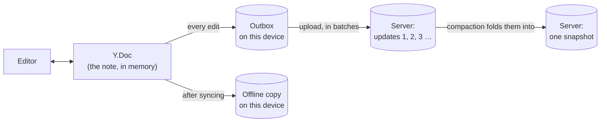
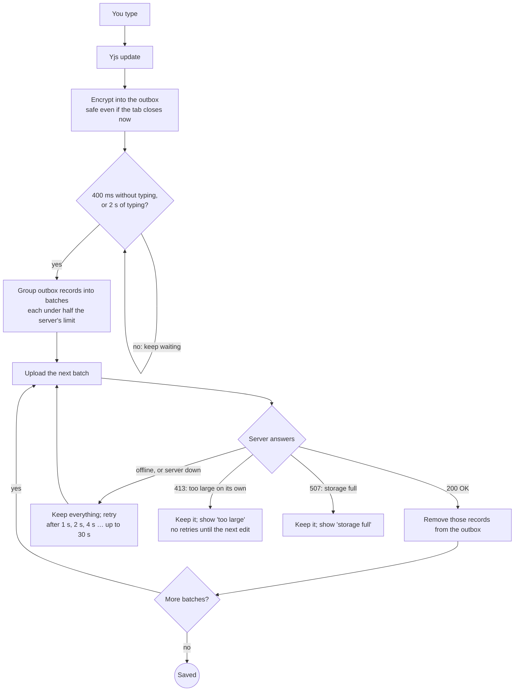
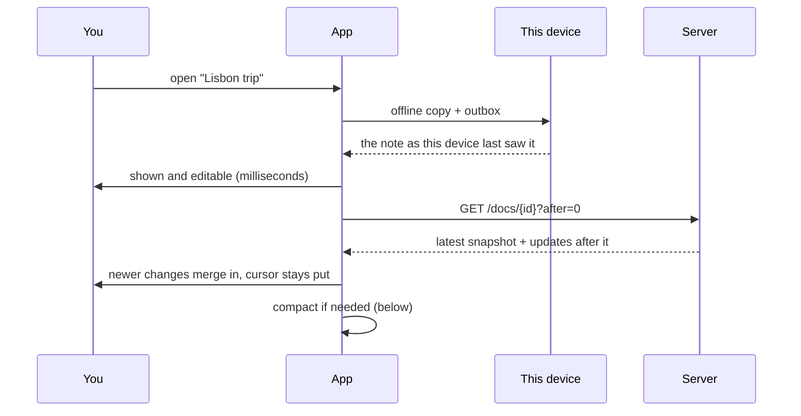
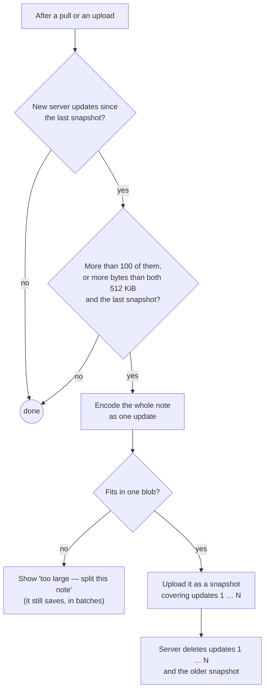
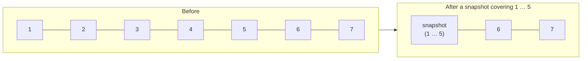

# How notes sync

How Plim stores, encrypts and syncs a note: CRDTs in brief, the outbox, uploads, loading, and the snapshot pattern that keeps notes quick to load. The web app (`web/core/sync.js`) and the terminal client (`crates/plim-cli/src/sync.rs`) follow the same rules.

## CRDTs in two minutes

Every note is a **[Yjs](https://yjs.dev) document**, a kind of CRDT (*conflict-free replicated data type*).

- **Every edit is a small "update".** Typing "hi" produces an update saying, roughly, "client 4711 inserted `h` and `i` after item 4711:12". Each character gets a permanent ID made of the device's client number and a counter.
- **Updates merge in any order.** Applying the same set of updates gives the same text on every device, whatever order they arrive in, and an update applied twice changes nothing. That's why two devices can edit the same note offline and both edits survive: there's nothing to "resolve".
- **A state vector** records, for each client, how far the document has seen its edits (client 4711 up to 120, client 9 up to 35). It tells a device what it's missing. Plim also uses it to notice a server that serves *less* than before (see [Rollback detection](#rollback-detection)).
- **Deleting keeps a small marker.** Deleted text is dropped, but a tiny tombstone records that the IDs existed, so later edits from other devices still land in the right place. A note's encoded state therefore grows a little with its edit history, not just with its current text.
- **A whole document can be encoded as one update** (`encodeStateAsUpdate`). That's what a snapshot is.
- **Undo keeps deleted text.** The editor's undo manager stops deleted text being discarded, so it can bring it back. Snapshots and the offline copy are therefore built from the *shadow* document (below), which has no undo manager, so text you deleted isn't stored.

The server never sees any of this. It stores opaque, encrypted, signed blobs, each with a sequence number.

## What is stored where

Opening a note reads it the other way: the snapshot plus any newer updates (see [Opening a note](#opening-a-note)).

| Where | What | Encrypted with |
|---|---|---|
| Outbox (IndexedDB, or the CLI's SQLite file) | each local edit, until the server has it | the note's key |
| Offline copy (web only) | the note's latest full state, to open it instantly or offline | the note's key |
| Server `updates` | uploaded edits, numbered 1, 2, 3 … per note | the note's key, and signed |
| Server `snapshots` | one full state per note, saying which `seq` it covers | the note's key, and signed |
| Server `versions` | earlier versions of a note's text (see [History](#history)) | the note's key, and signed |
| Server `share_updates`, `share_snapshots`, `share_versions` | the same, for a shared note | the share's key, and signed with its signing key |
| Server `gone_docs` | private docs that take no more writes: the note was shared (its text moved to the share) or deleted for good | nothing secret: account and doc IDs |

Each note has its own AES-256-GCM key, derived from the vault key. The authenticated data binds every blob to the account, the note and its kind (`update`, `snapshot`, `version`, `outbox`, `cache`), so a blob can't be swapped into another note or role.

## Saving: from keystroke to server

- **Big edits.** In the terminal client, anything over 128 KiB (a TUI paste, `plim add`, an edit saved from `$EDITOR`) is inserted as several pieces, each its own update, so no single edit is too big to upload. In the web app a paste is one update. It uploads on its own if it's bigger than a batch, and up to the server's limit (8 MiB by default); beyond that the note says it's too large.
- **The server's limit** (`PLIM_MAX_BLOB_BYTES`, 8 MiB by default) is read from `GET /api/account`. Guests on a shared note, who have no account, read it from `GET /api/shares/{id}`. Until it's known, clients assume the older 1 MiB.
- **Closing the tab** sends what it can with `keepalive`, which browsers limit to 64 KiB. Anything else waits in the outbox for next time.

## Opening a note

A note this device has never opened has no local copy, so it waits for the server. It only shows "Loading…" if that takes more than 250 ms.

## Staying up to date

**Live sync.** The web app keeps one WebSocket open (`/api/live`, `web/core/live.js`, `server/src/live.rs`) for the note list and the open note. When another device stores an edit, the server pushes it at once; uploads still go over HTTP. A shared note's other people see edits the same way, and their cursors and names travel over it too (encrypted with the share's key; the server only relays them). The connection signs in like the HTTP API, is checked by a ping every 30 s, and reconnects with backoff. The dot on a shared note's Share button is green while it's connected, grey while it reconnects.

**Polling** is the fallback, run by `web/core/live.js` itself (#261): the app fetches the note list and the open note (`pullChanges` in `web/app.js`), each with `?after=` the last `seq` it has, so an answer with nothing new is small. While the socket is up it polls only every 5 minutes, as a safety net. While it's down:

- **Every 5 s after activity.** Typing, opening a note, or a poll that brings changes keeps it at 5 s.
- **Backing off when idle.** Each poll that brings nothing doubles the gap, up to once a minute (5, 10, 20, 40, 60 s).
- **Hidden tabs don't poll.** Showing the tab again, or the browser coming back online, polls at once (socket or not: a dead socket is dropped at the same moment).
- **Storage use** (`GET /api/account`) is refreshed after this device saves or a poll brings changes (at most every 30 s), and otherwise every 5 minutes. An idle tab makes 2 requests a minute.

## The snapshot pattern (compaction)

Without snapshots, opening a note would mean downloading and decrypting every edit ever made to it. A **snapshot** is the note's whole current state, encoded as a single Yjs update. It's encrypted like any other blob and records which updates it covers (`covers_seq`).

**Example.** A note has had 7 updates when a device compacts it:

A device opening the note fetches **one snapshot plus updates 6 and 7**, not seven updates.

- **Why size counts too.** Compaction used to wait for 100 updates. A note whose big pasted body was replaced a dozen times never got there, and every open downloaded all of it: 5.7 MB for a 0.4 MB note. Counting bytes as well brings that down to roughly the note's size plus its most recent edits.
- **Who compacts.** Any device that has caught up with the server: after loading a note, after polling, or right after uploading, if its upload directly follows what it had already fetched.
- **Two devices compacting at once** is harmless. The server keeps the snapshot covering the most, and turns down an older one with `409`.
- **Pruning.** By default the server deletes the updates a snapshot covers (`PLIM_PRUNE_ON_SNAPSHOT=0` keeps them). Nothing reads them afterwards, and keeping them would count every deleted paste against the storage quota forever. At startup, the server also prunes anything already covered and recounts usage.
- **Limit.** A snapshot must fit in one blob, so a single note can hold about 8 MiB. A bigger note still saves, but can't be compacted, and says so.

## Offline

Edits always go to the outbox first, so saving never depends on the server answering. The offline copy lets a note open without the server, and the service worker (`web/sw.js`) lets the app itself load. When the server is back, the outbox uploads and the note merges with whatever changed meanwhile. See [Offline](../README.md#offline) in the README.

## Rollback detection

Each device keeps a second Yjs document, the **shadow**, holding only what the server has *confirmed*: what it delivered, and what it accepted from this device. The shadow's state vector is saved on the device.

If the server later delivers less than that (an update missing, or an older snapshot without the updates after it), or updates whose predecessors never arrived, the app warns. That covers, for example, a restored backup or withheld data. The state vector lives inside the encrypted updates, so the server can't fake it. The keyring version is checked the same way.

The offline copy is deliberately kept out of the shadow, so only the server's own answers count.

## A note that moves while another device is editing it

Sharing a note moves its text from its private doc into the share. The private doc is **closed** first (`POST /docs/{id}/close`: no more writes), then its final text is read and copied, then it's deleted. Another device's edits that arrive after the close are refused (`410 Gone`) and stay in its outbox; once that device's note list says the note is shared, it applies them to the share (made from the same doc, so they fit) and uploads them there (`moveUnsent` in `web/app.js`). Stopping sharing reopens the private doc (`POST /docs/{id}/reopen`). "Delete forever" leaves the doc closed too: a late edit is refused and dropped. The server keeps a deleted doc's or share's rows for 30 days in its `trash` table (`server/src/trash.rs`, #253), out of reach of every read and sync and not counted in the quota (capped at it), so "Deleted forever" in Recently deleted can restore it (`POST /trash/{doc|share}/{id}/restore`); the note list keeps the note's title and, for a shared one, its link's key that long (`markPurged` in `web/core/trash.js`). Closing, reopening and deleting a doc, like deleting a share, turning its links off and saving or removing a passkey's copy, are signed with the account's key over a fresh challenge (`X-Tiro-Nonce` and `X-Tiro-Sig`, over `tiro/v1/action`: the action and what it's done to), so a session alone, a stolen token say, can't do them (#144). The terminal client does the same: a note it has open that's shared (or unshared) elsewhere reopens in its new home, with its unsent edits moved there (`flush_into_share` in `crates/plim-cli/src/vault.rs`).

## The note index

Everything the list needs without opening a note (title, `created`, `updated`, `deleted`, a share's link, the markdown setting, the markers of notes deleted forever) is one Yjs doc, the **index**, synced exactly like a note: one `notes` map of small maps, one update per save, snapshots, an offline copy. It is **one doc on purpose**: every device agrees on the list the same way it agrees on a note's text, and nothing has to be joined. Its cost was measured in October 2026 (#262; `tools/bench/`, in Node and in Safari on the iPhone simulator):

| Notes | Saves per note | Index | Load, desktop / iPhone | Save, desktop / iPhone |
|---|---|---|---|---|
| 1,000 | 0 | 170 KiB | 6 / 14 ms | 3 / 12 ms |
| 1,000 | 20 | 357 KiB | 14 / 22 ms | 4 / 17 ms |
| 10,000 | 0 | 1.7 MiB | 57 / 60 ms | 16 / 44 ms |
| 10,000 | 20 | 3.6 MiB | 97 / 183 ms | 25 / 86 ms |
| 10,000 | 100 | 11.3 MiB | 479 / 552 ms | 61 / 149 ms |

*Load* is reading the offline copy (decrypt, apply into a fresh doc): what every start of the app pays before the list shows. *Save* is encoding the whole state and encrypting it: the offline copy written after a save, and a snapshot. A save's upload itself is one update of about 65 bytes whatever the size. Sorting the list over 10,000 notes takes under 10 ms.

What this says:

- **A note costs about 175 bytes; an overwrite about 10.** Yjs keeps a tombstone for every value replaced, so the index grows with *saves*, not only with notes: 10,000 notes with 100 saves each is 11 MiB, over the server's 8 MiB blob limit (a snapshot must fit in one blob), while the same notes untouched are 1.7 MiB. That is why clients write `updated` at most every 30 s while typing, and the title only when it changed.
- **The index is fine as one doc up to a few thousand notes** (a few hundred KiB, loads in tens of milliseconds on a phone) and workable at 10,000 (a second or less at start, after years of edits). Beyond that, the lever is a **rewrite**: a new index doc holding only live values (no tombstones), that devices switch to once they've seen it. Not built; nothing planned needs it.
- **What belongs in the index:** a few bytes per note that the list sorts or filters by. Folders, tags and favourites (#171, #172) are that: 10,000 notes with a folder and three tags add about 300 KiB. Search (#24) and anything else that reads a note's *text* does not belong in it; that is a separate local index of the offline copies. UUIDs in URLs (#204) need nothing from it.
- **Markers of notes deleted forever** stay, so a device that edited the note offline learns it is gone (see [A note that moves](#a-note-that-moves-while-another-device-is-editing-it)). After 30 days each shrinks to about 100 bytes; 10,000 of them would be 1 MiB. If that ever matters, the rewrite above is where they'd be dropped.

## Times

A note's `created` and `updated` (and when it was deleted, and its versions' times) are written by the device that made the change. So that a device with a wrong clock doesn't sort its notes wrongly for everyone, clients write them by the **server's clock**: each API answer's `Date` header says how far this device's clock is off (by more than 10 s counts; `web/core/clock.js`, `notes::now_ms` in the terminal client). Times are never shown as in the future, a future one sorts as now, and the next edit anywhere replaces it.

## History

Compaction throws edits away, so the history of a note is kept separately, as **versions**: the note's whole text at a moment, encrypted with the note's key and signed like its edits (`web/core/history.js`, `server/src/versions.rs`).

- **When:** on the first edit of a session, the note as it was before it (if the last version is older than an hour); then at most once an hour while edits keep coming. The server says how often (`version_every_secs` in `GET /api/account`).
- **What's kept:** every version. Each is packed (its text raw-deflated, after a 4-byte marker: `plim-core` `version.rs`, `web/core/history.js`) before it's encrypted, so a note's whole history costs a fraction of its copies. When a write would take an account past its quota, or a shared note past its cap, the oldest versions (the account's, or that note's) are deleted first, as many as needed: history never stops a note being written. If even all of them wouldn't make room, none is deleted and the write is refused as before.
- **Their time is signed** (as the blob's `covers_seq`), so the server can't reorder them, and they keep their times when re-encrypted after a phrase change.
- **They count** against the storage quota, and go when the note is deleted for good.
- **The History dialog** shows what each version changed since the one before (a line diff, with the changed words marked: `diffLines` in `web/core/history.js`, run in the browser on the decrypted texts), or its whole text.
- **Restore** (the History dialog) saves the note as it is as a version, then makes the text read like the old one with the smallest single edit (`applyText`), so it syncs and merges like typing.
- **When someone else wipes a note** (an edit arriving that removes at least 50 characters and over half the text), the app keeps the text from just before, whatever the interval.
- **Shared notes** keep versions too, encrypted with the share's key and signed with its signing key (so saved by anyone with the edit link; anyone with a link can read them). Clients check that signature before showing one (#77). They count toward the share's cap and the owner's quota, and a note's versions follow it when it's shared, its links replaced, or sharing stopped.
- **The terminal client** keeps versions as the app does: the note as it was before a session's first edit, then at most one an hour while it's edited, in its editor and with `plim append`, `plim edit` and `plim tag`.

## Where to look in the code

| What | Web app | Terminal client |
|---|---|---|
| Outbox, uploads, batches, compaction, rollback | `web/core/sync.js` (`DocSync`) | `crates/plim-cli/src/sync.rs` |
| The editor ↔ Yjs binding | `web/editor/editor.js` (CodeMirror 6 + `y-codemirror.next`) | `crates/plim-cli/src/tui/binding.rs` |
| Splitting big inserts | — (one update per paste) | `crates/plim-cli/src/notes.rs` (`insert_chunked`) |
| Local storage | `web/core/vault.js` (IndexedDB) | `crates/plim-cli/src/store.rs` (SQLite) |
| Live sync (pushes, presence) | `web/core/live.js`, `web/core/presence.js` | — (polls every 5 s; #135) |
| Shared notes | `web/core/share.js`, `web/core/sharesync.js` (`ShareDocSync`), `web/guest.js` (the link's page) | `crates/plim-cli/src/sync.rs` (`ShareHome`, `DocSync::new_share`), `link.rs` (links), `sharing.rs` (`plim share`, `unshare`) |
| History (versions, restore) | `web/core/history.js` | `crates/plim-cli/src/vault.rs` (saving), `sync.rs` (`copy_versions_to`, when a note moves), `commands/history.rs` (`plim history`, `restore`) |
| Server side: limits, snapshots, pruning | `server/src/docs.rs`, `server/src/quota.rs`, `server/src/db.rs` (`prune_covered`) | |
| Server side: live sync, shares, versions | `server/src/live.rs`, `server/src/shares.rs`, `server/src/versions.rs` | |

## Names that still say tiro

Plim was called Tiro. Some names keep the old one on purpose, because changing them would break existing accounts, devices or servers:

- **The protocol's labels:** every `tiro/v1/...` string (key derivation in `crates/plim-core/src/crypto.rs`, signature tags and AADs in `sig.rs`, the same in `web/core`). Keys come from the recovery phrase and these labels, and signatures cover them: new labels would mean new keys, and no account could open its notes.
- **HTTP headers:** `X-Tiro-Version`, `X-Tiro-Nonce`, `X-Tiro-Sig`, `X-Tiro-Connection`, `X-Tiro-Connection-Sig`. Clients already installed send and read these.
- **What a browser keeps:** the IndexedDB database `tiro` (`web/core/vault.js`: the vault itself), the `tiro-*` keys in localStorage and sessionStorage, the service worker's caches (`tiro-page`, `tiro-v-<hash>`), the `tiro-flush` lock and the `tiro` BroadcastChannel (an open tab of the old version and one of the new must still see each other).
- **What a server keeps:** the database file `tiro.db` (the image's `PLIM_DB=/data/tiro.db`), and `/app/tiro-server` in the image, a link to `plim-server` for health checks that still name it.
- **Settings:** each `PLIM_*` environment variable is also read by its old name, `TIRO_*`, when it isn't set.

Everything else is Plim: the crates (`plim-core`, `plim-cli`, `plim-wasm`, `plim-server`), the binaries, `web/wasm/plim.wasm`, and the text.
